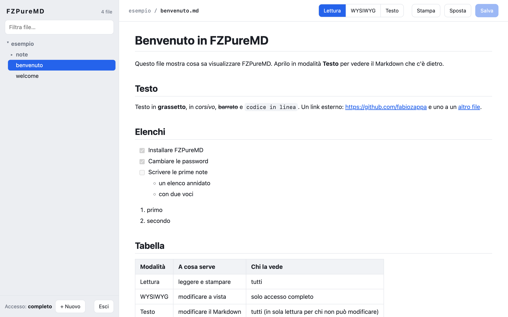

# FZPureMD

🇬🇧 [English version](README.md)

**Visualizzatore ed editor di file Markdown in un solo file PHP.** Copi `FZPureMD.php` in una cartella, imposti due password, lo apri nel browser: trovi tutti i file `.md` di quella cartella e delle sottocartelle, pronti da leggere, modificare, spostare e stampare. Nessuna libreria, nessun database, niente Composer, nessun file esterno, niente caricato da internet.



## Cosa fa

- **Albero dei file** a sinistra con tutti i `.md` della cartella e delle sottocartelle, con un campo per filtrarli.
- **Tre modalità** per il file aperto:
  - **Lettura**: il documento formattato. I link relativi ad altri `.md` si aprono dentro FZPureMD, le immagini relative vengono mostrate.
  - **WYSIWYG**: modifica visuale con una barra di formattazione (grassetto, corsivo, titoli, elenchi, citazioni, codice, link, immagini).
  - **Testo**: il Markdown in testo semplice.
- **Salvataggio** con il pulsante o con Cmd/Ctrl+S. Se qualcun altro ha modificato il file dopo che l'hai aperto, ti chiede conferma prima di sovrascriverlo. Se lasci la pagina con modifiche non salvate, ti avvisa.
- **Nuovo file** e **sposta / rinomina**: le cartelle che non esistono vengono create.
- **Stampa**: stampa sempre solo il documento formattato, su fondo bianco, senza spezzare a metà pagina codice, tabelle e immagini. Per avere un PDF scegli "Salva come PDF" nella finestra di stampa.
- **Due password**: una per l'accesso completo, una per la sola lettura.
- Si adatta allo schermo del telefono e segue il tema chiaro/scuro del sistema.

## Cosa serve

- Un server web con PHP. FZPureMD è stato sviluppato e provato su PHP 8.5 ed è scritto per restare compatibile con **PHP 5.3 e successivi**: non servono estensioni PHP.
- Un browser recente.
- Per salvare, creare e spostare file, l'utente del server web deve poter scrivere nella cartella.

## Installazione

1. Copia `FZPureMD.php` nella cartella che contiene i tuoi file Markdown. Mostra quella cartella e tutte le sottocartelle.
2. Apri `FZPureMD.php` con un editor di testo e cambia le due password in cima:

   ```php
   define('MD_PASS_ADMIN', 'cambiami-admin');    // accesso completo
   define('MD_PASS_READ',  'cambiami-lettura');  // sola lettura
   ```

   Finché non le cambi **nessuno può entrare**. Devono avere almeno 8 caratteri ed essere diverse tra loro.
3. Apri `https://tuo-sito/percorso/FZPureMD.php` nel browser ed entra.

Puoi rinominare il file come preferisci (per esempio `note.php`): funziona allo stesso modo.

La cartella [`esempio/`](esempio/) contiene alcuni file per provarlo (`benvenuto.md` in italiano, `welcome.md` in inglese). Puoi cancellarla.

## Configurazione

Tutto si trova in cima al file, nella sezione `CONFIGURAZIONE`.

| Impostazione | Predefinito | Cosa fa |
|---|---|---|
| `MD_PASS_ADMIN` | `cambiami-admin` | Password di accesso completo: lettura, modifica, nuovo file, spostamento. |
| `MD_PASS_READ` | `cambiami-lettura` | Password di sola lettura: modalità Lettura e Testo, nessuna modifica. |
| `MD_ROOT` | la cartella del file | La cartella da mostrare. |
| `$MD_SKIP` | `node_modules`, `vendor`, `bower_components` | Cartelle che non vengono esplorate. Quelle che iniziano con il punto sono sempre escluse. |
| `MD_MAX_DEPTH` | `12` | Quanti livelli di sottocartelle vengono esplorati. |
| `MD_IDLE` | 4 ore | Disconnessione automatica dopo questo tempo di inattività. |
| `MD_MAX_SIZE` | 5 MB | I file più grandi non vengono aperti. |

Se cambi una password, chi è collegato con quella viene disconnesso.

## Markdown supportato

Titoli (`#` e sottolineati), paragrafi e a capo forzati, **grassetto**, *corsivo*, ~~barrato~~, codice in linea, blocchi di codice (delimitati e rientrati), citazioni, elenchi puntati, numerati e annidati, liste di attività (`- [ ]` / `- [x]`), tabelle con allineamento delle colonne, linee orizzontali, link, link automatici, immagini, caratteri protetti con la barra rovesciata.

L'HTML scritto dentro i file `.md` viene **mostrato come testo** e non interpretato: è una scelta di sicurezza.

## Sicurezza

- Si possono aprire e modificare solo file `.md` dentro `MD_ROOT`; vengono rifiutati i percorsi con `..`, i file e le cartelle nascosti e i collegamenti simbolici che puntano fuori. Le immagini vengono servite solo se stanno dentro `MD_ROOT` e hanno un'estensione da immagine.
- Ogni modifica è protetta contro le richieste da altri siti (token CSRF), il cookie di sessione è `HttpOnly` e `SameSite=Lax` e la pagina invia una Content Security Policy restrittiva.
- Incollando nell'editor WYSIWYG viene inserito solo testo semplice.
- Una password sbagliata costa un secondo di attesa, per rallentare i tentativi.

Consigli:

- Usalo in **HTTPS**: in HTTP semplice la password viaggia in chiaro.
- Le password sono scritte in chiaro nel file PHP. È sicuro finché il server esegue PHP (il sorgente non arriva mai al browser), ma chi può leggere i file sul server può leggerle.
- Mettilo in una cartella che contiene solo i documenti che vuoi mostrare: tutto quello che sta sotto è visibile a chi ha una password.

## Limiti

- Se salvi dopo aver modificato in **WYSIWYG**, la formattazione del Markdown viene uniformata (per esempio un URL nudo diventa `<https://…>` e gli a capo semplici dentro un paragrafo diventano spazi). Il risultato visivo è lo stesso. La modalità **Testo** non tocca mai la formattazione.
- Sui telefoni l'editor WYSIWYG può comportarsi in modo strano con alcune tastiere touch: la modalità Testo è la più affidabile.
- Spostando un file, i link che puntano a lui da altri file non vengono aggiornati.
- Dall'interfaccia non si possono cancellare file.
- I file non in UTF-8 vengono convertiti all'apertura e salvati in UTF-8.

## Sostieni il progetto

Se questo progetto ti è utile, puoi offrirmi un caffè: è un modo semplice
per sostenerne lo sviluppo.

[](https://buymeacoffee.com/fabiozappa)

## Licenza

[MIT](LICENSE) © 2026 Fabio Zappa
