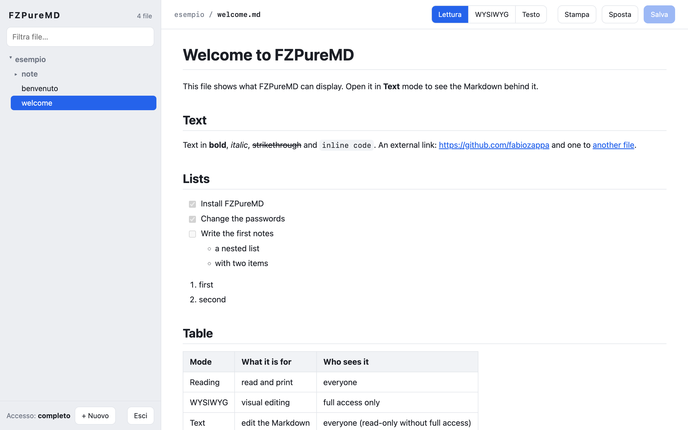

# FZPureMD

🇮🇹 [Versione italiana](README.it.md)

**A Markdown viewer and editor in a single PHP file.** Copy `FZPureMD.php` into a folder, set two passwords, open it in the browser: you get every `.md` file in that folder and its subfolders, ready to read, edit, move and print. No libraries, no database, no Composer, no external files, nothing loaded from the internet.



## What it does

- **File tree** on the left with every `.md` file in the folder and its subfolders, with a filter box.
- **Three modes** for the open file:
  - **Reading**: the formatted document. Relative links to other `.md` files open inside FZPureMD, relative images are shown.
  - **WYSIWYG**: visual editing with a toolbar (bold, italic, headings, lists, quotes, code, links, images).
  - **Text**: the plain Markdown source.
- **Save** with the button or Cmd/Ctrl+S. If someone else changed the file after you opened it, you are asked before overwriting. Leaving the page with unsaved changes asks for confirmation.
- **New file** and **move / rename**: missing folders are created.
- **Print**: always prints the formatted document only, on a white background, without breaking code blocks, tables and images across pages. Choose "Save as PDF" in the print dialog to get a PDF.
- **Two passwords**: one for full access, one for read-only access.
- Adapts to phone screens and follows the system light/dark theme.

The interface and the code comments are in Italian.

## Requirements

- A web server with PHP. FZPureMD has been developed and tested on PHP 8.5 and is written to stay compatible with **PHP 5.3 and later**: no PHP extensions are required.
- A recent browser.
- To save, create and move files, the web server user must be allowed to write in the folder.

## Installation

1. Copy `FZPureMD.php` into the folder that contains your Markdown files. It shows that folder and all its subfolders.
2. Open `FZPureMD.php` in a text editor and change the two passwords at the top:

   ```php
   define('MD_PASS_ADMIN', 'cambiami-admin');    // full access
   define('MD_PASS_READ',  'cambiami-lettura');  // read-only
   ```

   Until you change them **nobody can log in**. They must be at least 8 characters long and different from each other.
3. Open `https://your-site/path/FZPureMD.php` in the browser and log in.

You can rename the file as you like (for example `notes.php`): it works the same way.

The [`esempio/`](esempio/) folder contains sample files to try it out (`welcome.md` in English, `benvenuto.md` in Italian). You can delete it.

## Configuration

Everything is at the top of the file, in the `CONFIGURAZIONE` section.

| Setting | Default | What it does |
|---|---|---|
| `MD_PASS_ADMIN` | `cambiami-admin` | Full access password: read, edit, create, move. |
| `MD_PASS_READ` | `cambiami-lettura` | Read-only password: Reading and Text modes, no changes. |
| `MD_ROOT` | the file's folder | The folder to show. |
| `$MD_SKIP` | `node_modules`, `vendor`, `bower_components` | Folders that are not scanned. Folders starting with a dot are always skipped. |
| `MD_MAX_DEPTH` | `12` | How many subfolder levels are scanned. |
| `MD_IDLE` | 4 hours | Automatic logout after this much inactivity. |
| `MD_MAX_SIZE` | 5 MB | Larger files are not opened. |

If you change a password, everyone logged in with it is logged out.

## Supported Markdown

Headings (`#` and underlined), paragraphs and forced line breaks, **bold**, *italic*, ~~strikethrough~~, inline code, code blocks (fenced and indented), quotes, bulleted, numbered and nested lists, task lists (`- [ ]` / `- [x]`), tables with column alignment, horizontal rules, links, automatic links, images, backslash escapes.

HTML written inside `.md` files is **shown as text**, not interpreted: this is a security choice.

## Security

- Only `.md` files inside `MD_ROOT` can be opened and changed; paths with `..`, hidden files and folders and symbolic links pointing outside are refused. Images are served only if they are inside `MD_ROOT` and have an image extension.
- Every change is protected against cross-site requests (CSRF token), the session cookie is `HttpOnly` and `SameSite=Lax`, and the page sends a strict Content Security Policy.
- Pasting into the WYSIWYG editor inserts plain text only.
- A wrong password costs one second, to slow down guessing.

Recommendations:

- Use it over **HTTPS**: over plain HTTP the password travels unencrypted.
- The passwords are written in clear text in the PHP file. That is safe as long as the server runs PHP (the source is never sent to the browser), but anyone who can read the files on the server can read them.
- Put it in a folder that contains only the documents you want to show: everything below it is visible to whoever has a password.

## Limitations

- Saving after editing in **WYSIWYG** normalises the Markdown formatting (for example, a bare URL becomes `<https://…>` and single line breaks inside a paragraph become spaces). The result looks the same. **Text** mode never touches the formatting.
- On phones the WYSIWYG editor can behave oddly with some touch keyboards: Text mode is the most reliable.
- Moving a file does not update links pointing to it from other files.
- Files cannot be deleted from the interface.
- Files that are not UTF-8 are converted when opened and saved back as UTF-8.

## Support the project

If you find this project useful, you can buy me a coffee: a simple way to
support its development.

[](https://buymeacoffee.com/fabiozappa)

## Licence

[MIT](LICENSE) © 2026 Fabio Zappa
